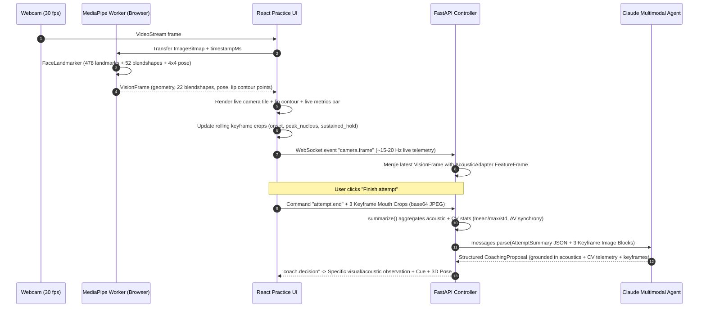

# Computer Vision & Multimodal Agent Research: Visual Speech Coach

This report synthesizes the computer vision (CV) foundation from [Visual_Speech_Coach_Roadmap.md](file:///c:/Users/Omkar/calhacks/Visual_Speech_Coach_Roadmap.md) and extends the [backbone.md](file:///c:/Users/Omkar/calhacks/backbone.md) architecture into a **full-telemetry, multimodal CV pipeline**. In this design, **MediaPipe Face Landmarker** extracts a comprehensive geometric, blendshape, and 3D head-pose feature set in real time, streams live telemetry to the backend, and pairs statistical attempt summaries with **keyframe screenshots** so the Claude coaching agent can perform joint **acoustic + geometric + visual inference**.

---

## 1. Why Joint Acoustic + Full-Telemetry CV + Keyframe Vision Matters

Acoustics ($F_1, F_2, F_0$) tell us *what resonance* the vocal tract produced, but not always *which visible articulator* caused an error. Combining **Parselmouth acoustics**, **MediaPipe continuous telemetry**, and **Claude multimodal keyframe inspection** solves the ambiguity problem:

| Target Vowel | Acoustic Target ($F_1, F_2$) | Visible Articulation Goal | How CV + Keyframes Diagnose Acoustic Errors |
| :--- | :--- | :--- | :--- |
| **`/u/` ("oo")** | Low $F_1$ ($350\text{ Hz}$)<br>Low $F_2$ ($900\text{ Hz}$) | **Lip rounding & protrusion** (`round-lips`): lips puckered forward into a tight circle, jaw nearly closed. | Lip rounding lengthens the vocal tract and lowers $F_2$. If $F_2$ is too high ($>1300\text{ Hz}$) and CV shows low `mouthPucker`/`mouthFunnel` or wide `lip_width`, the agent knows **unrounded lips** are the culprit. |
| **`/i/` ("ee")** | Low $F_1$ ($300\text{ Hz}$)<br>High $F_2$ ($2300\text{ Hz}$) | **Lip spreading** (`spread-lips`): corners retracted horizontally, narrow vertical aperture, teeth slightly visible. | Lip spreading shortens the front cavity and raises $F_2$. If $F_2$ is too low and CV/keyframes show slack or rounded lips, the agent cues **horizontal corner retraction**. |
| **`/ɑ/` ("ah")** | High $F_1$ ($750\text{ Hz}$)<br>Mid $F_2$ ($1200\text{ Hz}$) | **Mandibular jaw drop** (`open-jaw`): wide vertical opening, relaxed unrounded lips, flat low tongue. | $F_1$ rises directly with jaw and mouth opening. If $F_1$ is too low ($<550\text{ Hz}$) and CV/keyframes show small `lip_opening` / `jawOpen`, the agent cues **dropping the jaw wider**. |

---

## 2. Maximal MediaPipe Feature Extraction (`@mediapipe/tasks-vision`)

Running `FaceLandmarker` in a dedicated Web Worker with `outputFaceBlendshapes: true` and `outputFacialTransformationMatrixes: true` yields three complementary data streams on every video frame:

### 2.1 Stream 1: Scale-Invariant 2D/3D Lip & Jaw Geometry (from 478 Landmarks)

Raw landmark coordinates vary with camera distance. Normalizing all distances by the rigid **Inter-Ocular Distance ($D_{\text{IOD}}$)** between the left eye center ($C_L = \frac{P_{33} + P_{133}}{2}$) and right eye center ($C_R = \frac{P_{263} + P_{362}}{2}$), where $D_{\text{IOD}} = \|C_L - C_R\|_2$, provides distance-invariant metrics:

| Feature Name | Landmark Indices | Mathematical Definition | What It Captures |
| :--- | :--- | :--- | :--- |
| **`lip_opening`** *(Inner Vertical Aperture)* | Upper inner: `13`<br>Lower inner: `14` | $$H_{\text{inner}} = \frac{\|P_{13} - P_{14}\|_2}{D_{\text{IOD}}}$$ | True oral opening between the inner vermilion borders. Primary separator for `/ɑ/`. |
| **`outer_lip_height`** *(Total Vermilion Height)* | Upper crest: `0`<br>Lower base: `17` | $$H_{\text{outer}} = \frac{\|P_{0} - P_{17}\|_2}{D_{\text{IOD}}}$$ | Total vertical span of the lips including tissue thickness. |
| **`vermilion_flare`** *(Lip Eversion / Funnel)* | Outer (`0, 17`) minus Inner (`13, 14`) | $$V_{\text{flare}} = H_{\text{outer}} - H_{\text{inner}}$$ | Increases when lips flare/protrude outward (`mouthFunnel`) during `/u/`, decreases when lips roll inward (`mouthRoll`). |
| **`lip_width`** *(Inter-Commissural Spread)* | Left corner: `61`<br>Right corner: `291` | $$W_{\text{norm}} = \frac{\|P_{61} - P_{291}\|_2}{D_{\text{IOD}}}$$ | Horizontal mouth width. High for spread `/i/`, low for puckered `/u/`. |
| **`lip_aspect_ratio`** *(Orifice Circularity)* | Inner vertical vs. Outer width | $$\text{MAR} = \frac{\|P_{13} - P_{14}\|_2}{\|P_{61} - P_{291}\|_2}$$ | Ratio of vertical gap to horizontal width. |
| **`lip_protrusion_z`** *(3D Forward Pucker)* | Lip center (`0, 13, 14, 17`) vs. Corners (`61, 291`) | $$Z_{\text{protrude}} = \frac{\bar{z}_{\text{corners}} - \bar{z}_{\text{center}}}{D_{\text{IOD}}}$$ | MediaPipe's $z$ coordinate is negative toward the camera. Measures 3D forward protrusion of the lips relative to the mouth corners. |
| **`jaw_drop`** *(Mandibular Excursion)* | Subnasale: `2`<br>Menton (Chin): `152` | $$J_{\text{norm}} = \frac{\|P_{2} - P_{152}\|_2}{D_{\text{IOD}}}$$ | Tracks skeletal lower-jaw drop even if the lips remain partially tensed. |
| **`mouth_symmetry`** *(Lateral Balance)* | Left corner `61`, Right corner `291`, Midline `2`–`152` | $$S_{y} = \frac{|(P_{61} - P_{291}) \cdot \hat{u}_{\text{up}}|}{D_{\text{IOD}}}$$ | Detects asymmetric retraction or one-sided tension during vowel production. |
| **`inner_mouth_area`** *(Normalized Orifice Polygon)* | 20 inner lip contour points (`78, 191, 80, 81, 82, 13, ...`) | $$A_{\text{norm}} = \frac{\text{ShoelaceArea}(P_{\text{inner}})}{D_{\text{IOD}}^2}$$ | Exact 2D area of the open oral cavity normalized by squared inter-ocular distance. |

### 2.2 Stream 2: Complete Oral & Mandibular Blendshape Vector (22 Coefficients)

Out of MediaPipe's 52 ARKit blendshapes, 22 directly measure oral, labial, and mandibular muscle groups (scores in $[0.0, 1.0]$):

* **Jaw / Mandible (4):** `jawOpen`, `jawForward`, `jawLeft`, `jawRight`
* **Lip Rounding & Protrusion (4):** `mouthPucker`, `mouthFunnel`, `mouthShrugUpper`, `mouthShrugLower`
* **Lip Spreading & Retraction (6):** `mouthSmileLeft`, `mouthSmileRight`, `mouthStretchLeft`, `mouthStretchRight`, `mouthDimpleLeft`, `mouthDimpleRight`
* **Vertical Lip Elevation / Depression (4):** `mouthUpperUpLeft`, `mouthUpperUpRight`, `mouthLowerDownLeft`, `mouthLowerDownRight`
* **Lip Compression, Closure & Cheek Tension (5):** `mouthClose`, `mouthPressLeft`, `mouthPressRight`, `mouthRollUpper`, `mouthRollLower`, `cheekPuff`

Derived composite blendshape indices computed per frame:
* **`rounding_score`** $= \max(\text{mouthPucker}, 0.7 \cdot \text{mouthPucker} + 0.3 \cdot \text{mouthFunnel})$
* **`spread_score`** $= \frac{1}{4}(\text{mouthSmileLeft} + \text{mouthSmileRight} + \text{mouthStretchLeft} + \text{mouthStretchRight})$
* **`openness_score`** $= 0.7 \cdot \text{jawOpen} + 0.15 \cdot (\text{mouthLowerDownLeft} + \text{mouthLowerDownRight}) - 0.5 \cdot \text{mouthClose}$

### 2.3 Stream 3: 3D Head Pose & Capture Quality (from $4 \times 4$ Transformation Matrix)

From `facialTransformationMatrixes[0]` (column-major $4 \times 4$ matrix $M$ with rotation submatrix $R$):

$$\text{pitch } (\theta_x) = \arcsin(-R_{1,2}), \quad \text{yaw } (\theta_y) = \text{atan2}(R_{0,2}, R_{2,2}), \quad \text{roll } (\theta_z) = \text{atan2}(R_{1,0}, R_{1,1})$$

* **Pose Compensation & Quality Gating:**
  * Moderate yaw ($|\theta_y| \le 25^\circ$) can be cosine-corrected for horizontal width: $W_{\text{corrected}} = \frac{W_{\text{norm}}}{\cos(\theta_y)}$.
  * Extreme angles ($|\theta_y| > 25^\circ$ or $|\theta_x| > 20^\circ$) emit quality flag `"camera_angle_extreme"` so foreshortening is never misinterpreted by the agent.

---

## 3. Keyframe Screenshot Capture & Multimodal Agent Pipeline

Streaming raw 30 fps video to an LLM is slow and expensive, whereas sending **strategic keyframe mouth crops** alongside continuous numerical telemetry gives Claude high-resolution visual perception with negligible latency.

### 3.1 Smart 3-Keyframe Selection Strategy

During each attempt (`capturing` state), the browser maintains a rolling buffer of cropped lower-face/mouth snapshots (`256×256` JPEG at `0.78` quality, ~12 KB each, computed from the bounding box of landmarks `2, 152, 234, 454` with 25% padding):

1. **Keyframe 1 — `onset` (Baseline / Preparation):** Captured at attempt start or just before the first voiced acoustic frame (`f0 != null`). Shows resting/preparatory posture.
2. **Keyframe 2 — `peak_nucleus` (Peak Articulation during Voiced Speech):** Updated whenever a frame has valid acoustics (or maximal articulatory excursion $\text{jawOpen} + \text{rounding\_score} + \text{spread\_score}$) and valid head pose. Represents the learner's strongest articulation of the vowel.
3. **Keyframe 3 — `sustained_hold` (Late-Attempt Stability):** Captured near the 75th–85th percentile of the voiced segment duration. Reveals whether the learner held the lip/jaw posture steadily or relaxed prematurely before finishing the sound.

> [!TIP]
> **Token & Latency Efficiency:**
> In the Anthropic Messages API, a `256×256` image costs $\frac{256 \times 256}{750} \approx 87\text{ tokens}$. Sending 3 keyframe crops (or stitching them into a single `768×256` labeled horizontal filmstrip `[Onset | Peak Nucleus | Sustained Hold]`) costs **~260 tokens total** (~35 KB over WebSocket/HTTP), adding $<80\text{ ms}$ to the Claude request while allowing the agent to visually inspect lip rounding, teeth visibility, jaw drop, and symmetry.

### 3.2 End-to-End Multimodal Data Flow



---

## 4. Proposed Schema & Agent Extensions for `Articulate`

To support full CV telemetry and multimodal agent inference in `Articulate` ([schemas.py](file:///c:/Users/Omkar/calhacks/Articulate/services/api/app/schemas.py), [features.py](file:///c:/Users/Omkar/calhacks/Articulate/services/api/app/features.py), [coaching.py](file:///c:/Users/Omkar/calhacks/Articulate/services/api/app/coaching.py), and [providers.py](file:///c:/Users/Omkar/calhacks/Articulate/services/api/app/providers.py)):

### 4.1 Rich Telemetry Models in `schemas.py`

```python
class VisionMetrics(Model):
    timestamp_ms: float = Field(ge=0)
    valid: bool
    quality_flags: list[str] = Field(default_factory=list, max_length=10)
    # Scale-invariant geometry (IOD-normalized)
    lip_opening: float | None = Field(default=None, ge=0, le=2)
    outer_lip_height: float | None = Field(default=None, ge=0, le=2)
    vermilion_flare: float | None = Field(default=None, ge=0, le=2)
    lip_width: float | None = Field(default=None, ge=0, le=3)
    lip_aspect_ratio: float | None = Field(default=None, ge=0, le=3)
    lip_protrusion_z: float | None = Field(default=None, ge=-1, le=1)
    jaw_drop: float | None = Field(default=None, ge=0, le=3)
    mouth_symmetry: float | None = Field(default=None, ge=0, le=1)
    inner_mouth_area: float | None = Field(default=None, ge=0, le=2)
    # Composite & key oral blendshapes [0, 1]
    rounding_score: float | None = Field(default=None, ge=0, le=1)
    spread_score: float | None = Field(default=None, ge=0, le=1)
    openness_score: float | None = Field(default=None, ge=0, le=1)
    blendshapes: dict[str, float] = Field(default_factory=dict)
    # 3D Head Pose (degrees)
    pitch_deg: float | None = None
    yaw_deg: float | None = None
    roll_deg: float | None = None


class VisionKeyframe(Model):
    label: Literal["onset", "peak_nucleus", "sustained_hold"]
    timestamp_ms: float = Field(ge=0)
    mime_type: Literal["image/jpeg", "image/webp"] = "image/jpeg"
    data_base64: str = Field(max_length=120_000)
    metrics: VisionMetrics | None = None


class VisionSummary(Model):
    usable_frames: int = Field(ge=0)
    total_frames: int = Field(ge=0)
    usable_fraction: float = Field(ge=0, le=1)
    quality_flags: list[str] = Field(default_factory=list)
    # Mean & peak values across usable frames (especially voiced nucleus)
    lip_opening_mean: float | None = None
    lip_opening_max: float | None = None
    lip_width_mean: float | None = None
    lip_width_min: float | None = None
    lip_aspect_ratio_mean: float | None = None
    lip_protrusion_z_mean: float | None = None
    jaw_drop_mean: float | None = None
    mouth_symmetry_mean: float | None = None
    rounding_score_mean: float | None = None
    rounding_score_max: float | None = None
    spread_score_mean: float | None = None
    spread_score_max: float | None = None
    openness_score_mean: float | None = None
    openness_score_max: float | None = None
    # Stability (standard deviation during vowel nucleus)
    posture_stability_std: float | None = None
    blendshapes_mean: dict[str, float] = Field(default_factory=dict)
    head_pose_mean: dict[str, float] = Field(default_factory=dict)
    keyframes_count: int = Field(default=0, ge=0, le=4)
```

### 4.2 Multimodal Call in `Reasoner.decide` (`providers.py`)

When keyframes are present on an attempt, [`Reasoner.decide`](file:///c:/Users/Omkar/calhacks/Articulate/services/api/app/providers.py#L134-L170) builds a multimodal user message combining the structured JSON telemetry and the `image` blocks:

```python
content_blocks: list[dict] = [
    {
        "type": "text",
        "text": json.dumps(
            {
                "summary": summary.model_dump(mode="json"),
                "vision_summary": vision_summary.model_dump(mode="json") if vision_summary else None,
                "generation_id": str(generation),
                "attempt_id": str(summary.attempt_id),
                "plan": options.model_dump(mode="json"),
                "cues": [c.model_dump() for c in cues],
                "recent_outcomes": [o.model_dump(mode="json") for o in context.cue_history[-4:]],
                "policy_version": context.policy.version,
            }
        ),
    }
]
for kf in keyframes[:3]:
    content_blocks.append(
        {
            "type": "text",
            "text": f"Keyframe '{kf.label}' at {round(kf.timestamp_ms)} ms:",
        }
    )
    content_blocks.append(
        {
            "type": "image",
            "source": {
                "type": "base64",
                "media_type": kf.mime_type,
                "data": kf.data_base64,
            },
        }
    )
```

### 4.3 New CV-Grounded Observations in `coaching.py`

In addition to the existing acoustic observations (`target.inside`, `target.outside`, `trend.closer`, etc.), [`assess()`](file:///c:/Users/Omkar/calhacks/Articulate/services/api/app/coaching.py#L78-L123) and the agent can select or synthesize visual-articulatory observations when backed by `VisionSummary` + keyframe evidence:

* **`vision.lips_unrounded_for_u`**: Target is `/u/`, acoustic $F_2$ is high, and CV shows `rounding_score_mean < 0.30` / wide `lip_width_mean` $\rightarrow$ *"Your acoustic position stayed toward the front, and the camera shows your lips stayed wide—try puckering your lips forward into a tighter circle."*
* **`vision.lips_unspread_for_i`**: Target is `/i/`, acoustic $F_2$ is low, and CV shows `spread_score_mean < 0.22` $\rightarrow$ *"The camera shows your mouth corners stayed relaxed—try spreading the corners of your lips gently outward like a small smile."*
* **`vision.jaw_closed_for_aa`**: Target is `/ɑ/`, acoustic $F_1$ is low, and CV shows `lip_opening_mean < 0.22` / low `jawOpen` $\rightarrow$ *"The camera shows your lips and jaw stayed mostly closed—try dropping your lower jaw wider for a more open 'ah'."*
* **`vision.posture_matched`**: Target posture (rounding for `/u/`, spreading for `/i/`, jaw drop for `/ɑ/`) was visibly achieved on camera, reinforcing the learner's physical movement even if acoustics still need fine-tuning.
