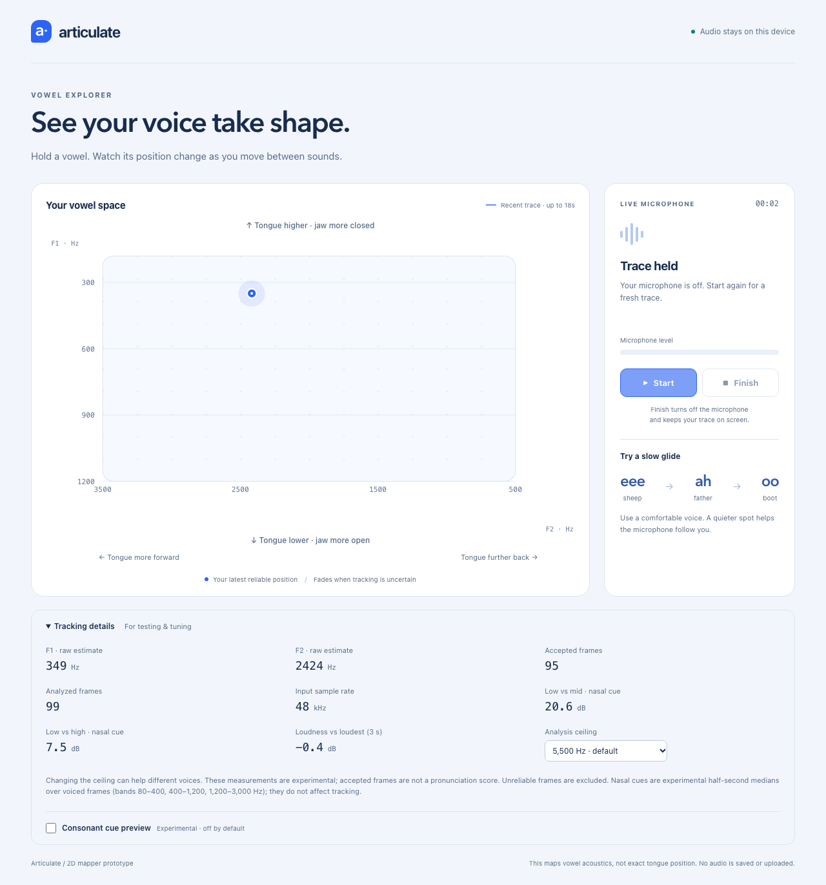
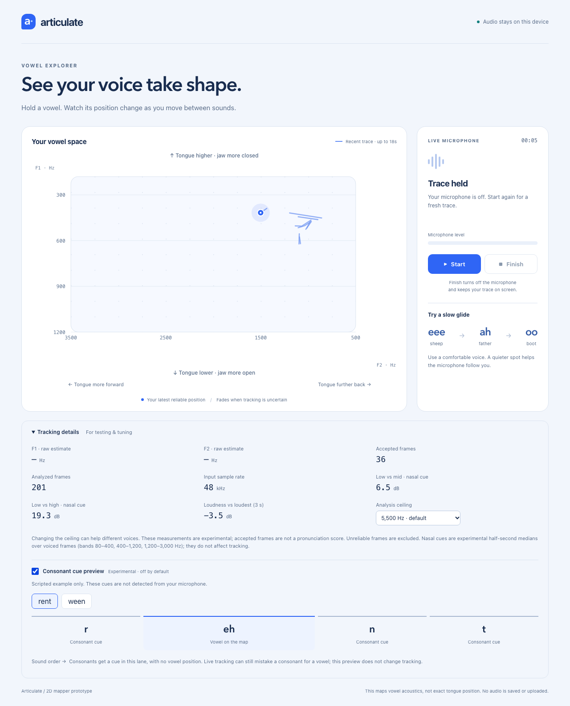

# Real-speech browser checks

Chromium used `--use-file-for-fake-audio-capture` with 48 kHz mono PCM16 WAVs. The production capture code requested disabled AGC, echo cancellation and noise suppression. No `getUserMedia` replacement was installed. All four runs reached accepted positions, Finish held the trace, and no page errors occurred.

| Fixture | Accepted frames captured | Last tracked F1 / F2 Hz | Interpretation |
|---|---:|---:|---|
| Repeated 150 ms m01iy vowel excerpt | 95 | 349.6 / 2416.4 | Compact stable point; repetition is artificial, speech source is real |
| Original m01uw h-V-d word | 65 | 375.5 / 945.1 | Repeated word yields a compact back-vowel trace |
| LibriSpeech 777-126732-0071 natural sentence | 36 | 416.9 / 1501.1 | Sparse separate tracks; includes nasals and fricatives, but screenshot cannot assign each position to a phone |
| Original m01ei /eɪ/ word | 94 | 414.4 / 2252.4 | Natural diphthong path; not an ee→ah→oo synthetic trajectory |

These timing-dependent counts describe the captured run, not fixed assertions for every rerun. The assertion is that real speech reaches the UI through the actual pipeline. Accuracy comes from the offline reference comparison, not the image.

Inspected `held-vowel.png`, `natural-nasal-sentence.png` and `consonant-cue-mobile.png` directly. The held vowel is a stable blue position around 350/2400 Hz. The natural sentence has short disconnected tracks; its final cursor around 417/1501 does not prove nasal rejection. At 320 px the entire preview stays inside the viewport, its scripted cue warning is visible, and the n/t cues occupy a separate ordered lane with no coordinates on the map. The default-off checkbox is keyboard operable.

Two compact images are committed under `screenshots/`. The complete captures, original h-V-d and glide images, mobile image, and run JSON are in `/Users/Git/Articulate-overnight/screenshots/vowels/`.

